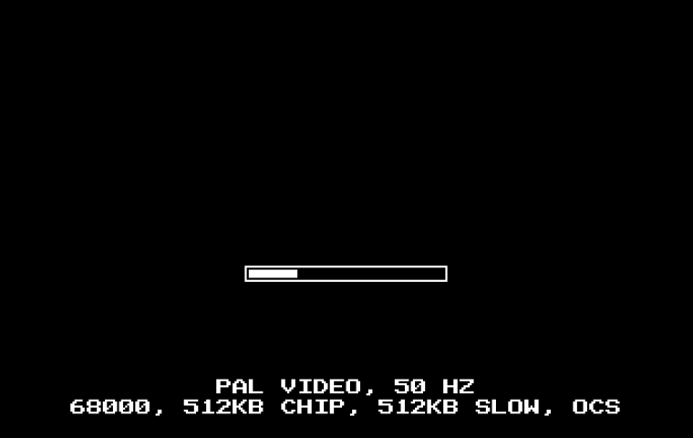
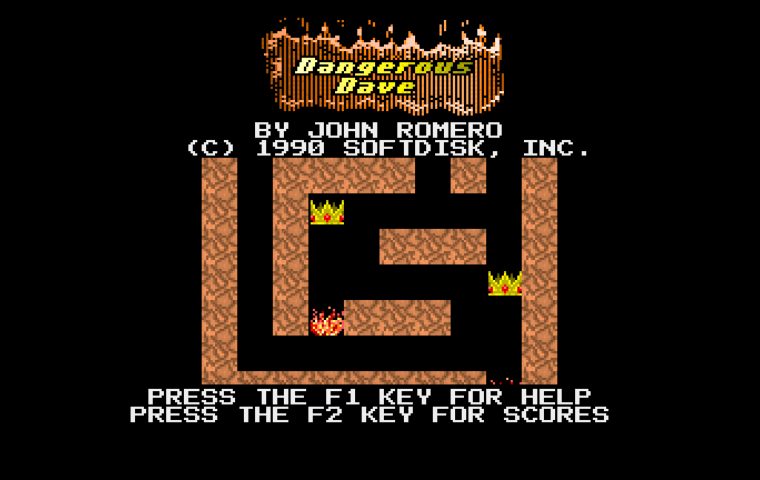
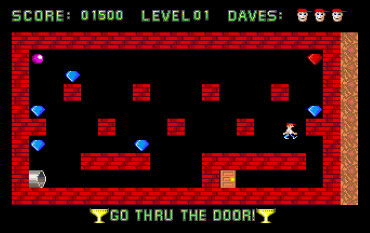
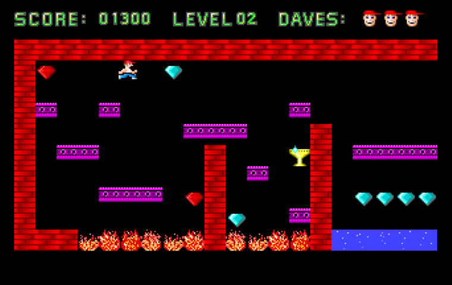

# Dangerous Dave — Amiga port

A port of John Romero's **Dangerous Dave** (Softdisk, 1990, DOS shareware)
to the Amiga. It runs bare-metal on the custom chips: 32 colours on
OCS/ECS, the original's exact 256-colour VGA palette on AGA, hardware
scrolling, blitter objects and the original PC-speaker sound effects
played on Paula.

| Loading (OCS) | Title (AGA) |
|---|---|
|  |  |
| **Level 1 (OCS)** | **Level 2 (AGA)** |
|  |  |

Everything from the original is here: all ten levels, Dave's movement
feel, the monsters and their flight paths, the jetpack, the gun, the four
warp zones, the intermission corridor, the title screen with its help
pages, the recorded attract-mode demos, GAME OVER, the high score table
(saved to `DSCORES.DAV`) and the congratulations at the end. It runs at
the same speed on PAL (50 Hz) and NTSC (60 Hz) machines.

Graphics, levels, monster paths and sounds come from the original
`DAVE.EXE`; the game logic is a C re-implementation, checked against a
disassembly of the original and guided by the open source projects under
[Credits](#credits).

## Requirements

- Any Amiga with **512 KB chip RAM** and **Kickstart 1.3** or later.
  - OCS / ECS (A500, A500+, A600, A2000, A3000): the 32-colour version.
  - AGA (A1200, A4000): the 256-colour version, picked automatically.
- A joystick in port 2 (a second fire button works the jetpack), or the
  keyboard (recommended).

### Tested on

Real hardware:

| Machine | Kickstart |
|---|---|
| Amiga 4000 | 3.2.1 |
| Amiga 1200 (stock, no fast RAM) | 3.1 |
| Amiga 600 | 2.04 |
| Amiga 500 | 1.3 |

### Controls

| Action | Joystick (port 2) | Keyboard |
|---|---|---|
| Walk | left / right | cursor left / right |
| Jump | up | cursor up |
| Climb trees and vines | up / down | cursor up / down |
| Fire the gun (once found) | fire | Ctrl |
| Jetpack on / off (once found) | 2nd button | Shift |
| Quit (asks "QUIT? (Y OR N)") | right mouse button | Esc |
| Start from the title | fire | any key |
| Help (3 pages, from the title) | — | F1, then Space / Esc |
| High scores (from the title) | — | F2 |
| Name for a high score | — | letters, Backspace, Return |

At the start of a level, and after losing a life, Dave blinks and nothing
moves until you press a direction, fire or the jetpack key. Collect the
trophy, then leave through the door. An extra Dave every 20 000 points (at
most 3 spare).

**Warp zones**, as in the original: *"did you find the 4 warp zones? they
are located on levels 5,8,9 and 10. just jump off the top of the screen at
the extreme left or right edge of the world"*.

**High scores**: a top-five score opens the table — type up to three
letters and press Return. The table is saved as `DSCORES.DAV` in the
directory the game was started from, when you quit (the game never touches
the disk while it runs). Delete it to go back to the original table.

## Building

The toolchain is Bartman's
[amiga-debug](https://github.com/BartmanAbyss/vscode-amiga-debug) VS Code
extension (GCC for m68k, vasm, elf2hunk, exe2adf and an emulator). Install
it in VS Code; the Makefile finds it under
`~/.vscode/extensions/bartmanabyss.amiga-debug-*/bin/linux` on Linux, and
expects `C:/amiga-gcc/bin` plus the extension's `bin` folder on Windows.
Python 3 packs the assets; a host `gcc` builds the tests.

```sh
make          # dave.exe (the game) + the asset packages dave.ocs, dave.aga
make test     # host-side tests: PAL/NTSC tick timing, the package loader
make clean
```

`dave.ocs` and `dave.aga` are uncompressed ZIP archives of the files under
`assets/` (`unzip -l dave.ocs` lists one); the format is in
[docs/SADE_PACKAGE.md](docs/SADE_PACKAGE.md). The game reads them during the
loading screen, while the OS still runs, then takes over the hardware.

## Running in emulation

Kickstart ROMs are not included — use your own (e.g. from Amiga Forever).
By default the run targets look in `../roms` for `amiga500.rom`
(Kickstart 1.3) and `amiga1200.rom` (Kickstart 3.1).

**FS-UAE** (`sudo apt install fs-uae`):

```sh
make run                          # A500, KS 1.3, 512 KB chip + 512 KB slow: OCS
make run-aga                      # A4000, KS 3.1: AGA
ROMS=~/kickstarts make run        # ROMs elsewhere
KICK_OCS=/path/kick13.rom make run
```

`tools/run_fsuae.sh` builds a hard-disk folder in `run/<model>/` (the game,
both packages, an `S:startup-sequence` that starts it) and an FS-UAE
config next to it; the high scores of those runs are saved there. Extra
FS-UAE options can follow, e.g. `tools/run_fsuae.sh ocs --fullscreen=1`.

The AGA run target emulates an A4000: with some Kickstart 3.1 images,
FS-UAE's A1200 model freezes a few seconds into the title. This is an
emulation issue only; the game runs fine on a real stock A1200 (no fast
RAM, see [Tested on](#tested-on)).

**VS Code**: press **F5** and pick *Amiga 500*, *Amiga 1200* or
*Amiga 4000* (`.vscode/launch.json`, ROMs from `../roms`). The project
folder is the emulator's hard disk.

### Testing switches

| Where | Switch | Effect |
|---|---|---|
| `src/main.c` | `SKIP_TITLE` | 1 = straight into the game |
| `src/main.c` | `START_LEVEL` | first level played, 0-based |
| `src/level.c` | `TICKS_PER_SEC` | game speed (81; ~70 is the original) |
| `src/level.c` | `WALL_CLIMB` | 1 = the original's wall-climb quirk (default) |

### Debug mode

Debug mode is built into every version of the game, release builds
included; no rebuild is needed. To turn it on, type **123555** on the title
screen, on the number row or the numeric keypad. Digits never start the
game, so typing them is safe; a wrong digit just restarts the code. When
the code is complete the game plays the pickup sound and shows a
*DEBUG MODE IS ON* box listing the keys; close it with **Space** or
**Esc** and start a game as usual. Debug mode stays on until you quit the
game, and there is no way to turn it off before then.

During a level:

| Key | Effect |
|---|---|
| **J** | Fill the jetpack |
| **G** | Get the gun |
| **H** | Invulnerable on/off (pickup sound = on, wall-bump sound = off); stays as set across levels and games |
| **L** | Finish the level, as if through the door |
| **W** | Go into this level's warp zone (levels 5, 8, 9 and 10 only) |

J, G, L and W do nothing while you are inside a warp zone.

## Source layout

| Path | What it is |
|---|---|
| `src/main.c` | Load phase and loading bar, title / demo → game → ending loop, saves the high scores on exit |
| `src/title.c` | Title screen (logo, maze, fires), F1 help, F2 scores, idle → demo |
| `src/level.c` | Gameplay: Dave, collisions, pickups, monsters, shots, HUD, scrolling, QUIT? box, intermission, warp zones, demo playback, GAME OVER |
| `src/scores.c` | High score table: `DSCORES.DAV` format, the box, name entry |
| `src/end.c` | The congratulations screen after the last level |
| `src/sound.c` | The original SPK PC-speaker sound bank on Paula |
| `src/sysinfo.c` | Machine detection for the loading screen (CPU, memory, chipset, video, RTG) |
| `src/dave_assets.h` | Generated: frame indices, tile ids, HUD rectangles, tile flags |
| `libs/sade/` | SADE, the header-only bare-metal game library the port runs on ([docs/SADE_API.md](docs/SADE_API.md)) |
| `libs/ptplayer/` | Frank Wille's ptplayer (linked by SADE's audio module) |
| `support/` | Start-up and runtime support from amiga-debug |
| `assets/` | The game data: `game/ocs`, `title/ocs` (5 planes), `game/aga`, `title/aga` (8 planes), the font, levels, sounds, demos, the first high score table |
| `tools/` | `make_package.py` (packs the assets), `run_fsuae.sh` (FS-UAE launcher) |
| `tests/` | Host-side unit tests |

The assets were extracted from the shareware `DAVE.EXE` (LZEXE-unpacked:
tiles, VGA palette, levels, the SPK sound bank, monster paths, the five
demos) and converted to Amiga IFF sheets by tools that live in the SADE
development repository, not here.

## How it works, briefly

- **Screen** — 320×200 like the original: status bars in the screen's own
  planes, the 20×10-tile playfield a hardware-scrolled band shown through
  its own copper list; it slides 15 tiles when Dave nears an edge.
- **Colours** — OCS uses one shared 31-colour palette (the logo its own,
  under a copper split); AGA keeps the original VGA colours on one
  256-entry palette whose entries 1–31 are the OCS ones, so colour indices
  in the code mean the same on both.
- **Dave** — a port of deadly-dave's state machine, which replicates the
  original's feel (1-pixel collision substeps, the jump velocity table,
  steerable falls), keeping the original's wall-climb quirk.
- **Monsters** — ported from a disassembly of the original: start
  positions, fire rates, shot placement and hit tests per level.
- **Sound** — the SPK bank on Paula: one channel plays a square wave whose
  period is rewritten every step, a second times the steps; pitch, step
  length and priorities match the PC speaker.
- **Timing** — game logic at a fixed tick rate counted from real VBLs, so
  the speed is the same at 50 and 60 Hz; sprites are drawn interpolated
  between ticks.

## Background

Development started some 30 years ago, first in AMOS and then as a
learning project in Aztec C. It never got far: one screen, a few sprites,
and nights spent working out how the Amiga hardware worked with no proper
documentation beyond a few text files from BBSes and example code from
god-knows-where. Then Bartman's
[amiga-debug](https://github.com/BartmanAbyss/vscode-amiga-debug) came
along, and some time later Claude became usable. I started with basic
graphics tests and demos, then built an AMOS-like library (SADE), and
finally took one of my old PC favourites and finished the conversion.

## Credits

Original game: John Romero, Softdisk, 1990.

Amiga port: Zeljko Drascic, in C on SADE with Bartman's amiga-debug.

| Project | Used for |
|---|---|
| [MaiZure/lmdave](https://github.com/MaiZure/lmdave) | Tile, palette and level formats in `DAVE.EXE`; monster start positions; scores; HUD layout |
| [skoperst/deadly-dave](https://github.com/skoperst/deadly-dave) | Dave's movement, collision boxes, monster animation, jetpack fuel, intermission and warp tube levels |
| [yo-yo-yo-jbo/dangerous_dave](https://github.com/yo-yo-yo-jbo/dangerous_dave) | Warp zone tables; its unpacked `DAVE.EXE` was disassembled for the monster rules |
| [TASVideos: Dangerous Dave](https://tasvideos.org/GameResources/DOS/DangerousDave) | Warp zone rules |
| [mywave82/unlzexe](https://github.com/mywave82/unlzexe) | LZEXE unpacking (public domain) |
| [BartmanAbyss/vscode-amiga-debug](https://github.com/BartmanAbyss/vscode-amiga-debug) | Toolchain, emulator, start-up code |
| [ptplayer](https://aminet.net/package/mus/play/ptplayer) by Frank Wille | ProTracker replay in SADE (public domain, `libs/ptplayer/`) |

## Licence and legal

The game code and SADE are © 2026 Zeljko Drascic, MIT licence
([LICENSE](LICENSE), [libs/sade/LICENSE](libs/sade/LICENSE)); ptplayer
is public domain ([libs/ptplayer/LICENSE](libs/ptplayer/LICENSE)).

Dangerous Dave © 1990 Softdisk, Inc., by John Romero. This port is a free,
non-commercial fan project. The graphics, levels and sounds under
`assets/` come from the original shareware release and remain the
property of their owners; they are not covered by the MIT licence.

See [CHANGELOG.md](CHANGELOG.md) for the release history.
